# Rancangan Antarmuka dan Wireframe

Dokumen ini menjadi rancangan awal antarmuka untuk Karyawan, Atasan, dan Admin HR. Wireframe menunjukkan susunan informasi dan alur, bukan desain visual akhir dan bukan bukti bahwa halaman telah diimplementasikan.

Dashboard Admin HR serta halaman pengelolaan Unit Bisnis dan Bagian Organisasi sudah diimplementasikan sebagai tahap awal. Halaman lain dalam dokumen ini tetap berstatus rancangan sampai tersedia dan diuji.

## Tujuan Rancangan

- Menyediakan navigasi sederhana sesuai tugas setiap aktor.
- Menampilkan status, saldo, dan tindakan penting secara jelas.
- Mencegah pengguna melihat tindakan yang tidak sesuai tahap pengajuan.
- Menjaga formulir tetap nyaman pada ponsel dan desktop.
- Menjadi acuan sebelum view Blade dan komponen antarmuka dibuat.

## Prinsip Antarmuka

- Gunakan istilah yang sama dengan dokumentasi: Karyawan, Atasan, MO, Admin HR, saldo tersedia, dan tujuh status resmi.
- Tindakan utama diletakkan paling jelas, tetapi tindakan berbahaya seperti pembatalan atau penolakan memerlukan konfirmasi.
- Status tidak dibedakan berdasarkan warna saja; selalu sertakan teks atau ikon.
- Pesan validasi ditempatkan dekat field dan dirangkum di bagian atas jika perlu.
- Tombol yang tidak berwenang tidak ditampilkan, tetapi keamanan tetap diperiksa server.
- Data pribadi hanya ditampilkan sesuai kepemilikan dan hak akses.
- Ketika koneksi tidak tersedia, tampilkan halaman offline tanpa formulir transaksi.

## Struktur Navigasi

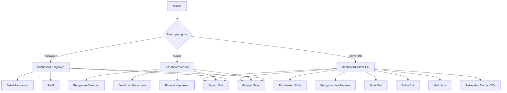

Atasan dan Admin HR tetap memiliki menu pengajuan pribadi karena keduanya juga merupakan pegawai. Keputusan terhadap pengajuan sendiri tidak pernah ditampilkan sebagai tindakan yang tersedia.

## Daftar Halaman yang Direncanakan

| ID halaman | Halaman | Aktor | Tujuan utama |
| --- | --- | --- | --- |
| UI-AUT-01 | Masuk | Semua pengguna | Membuat sesi pengguna aktif. |
| UI-KAR-01 | Dashboard Karyawan | Karyawan, Atasan, Admin HR | Melihat saldo dan ringkasan pengajuan pribadi. |
| UI-KAR-02 | Form Pengajuan Cuti | Karyawan, Atasan, Admin HR | Membuat, menyimpan, mengubah, dan mengirim draf. |
| UI-KAR-03 | Riwayat Pengajuan Saya | Karyawan, Atasan, Admin HR | Menyaring dan membuka pengajuan pribadi. |
| UI-KAR-04 | Detail Pengajuan Saya | Karyawan, Atasan, Admin HR | Melihat tanggal, status, riwayat keputusan, dan tindakan yang sah. |
| UI-ATS-01 | Dashboard Atasan | Atasan | Melihat jumlah pengajuan bawahan yang perlu diproses. |
| UI-ATS-02 | Daftar Pengajuan Bawahan | Atasan | Menemukan pengajuan `menunggu_atasan`. |
| UI-ATS-03 | Detail Keputusan Atasan | Atasan | Meninjau pengajuan lalu menyetujui atau menolak. |
| UI-ATS-04 | Riwayat Keputusan Atasan | Atasan | Melihat keputusan yang pernah diberikan. |
| UI-ATS-05 | Antrean Manager Operasional | MO | Menemukan pengajuan `menunggu_mo` dalam cakupan yang ditetapkan. |
| UI-HR-01 | Dashboard Admin HR | Admin HR | Melihat antrean keputusan akhir dan ringkasan operasional. |
| UI-HR-02 | Daftar Persetujuan Akhir | Admin HR | Menemukan pengajuan `menunggu_hr`. |
| UI-HR-03 | Detail Keputusan Akhir | Admin HR | Menyetujui atau menolak pada tahap akhir. |
| UI-HR-04 | Pengguna dan Pegawai | Admin HR | Mengelola akun, data pegawai, bagian organisasi, dan Atasan. |
| UI-HR-05 | Jenis Cuti | Admin HR | Mengelola jenis, jatah bawaan, dan status aktif. |
| UI-HR-06 | Saldo Cuti | Admin HR | Menerbitkan serta menyesuaikan saldo per tahun. |
| UI-HR-07 | Hari Libur | Admin HR | Mengelola tanggal libur aktif. |
| UI-HR-08 | Rekap Pengajuan | Admin HR | Menyaring data dan mengekspor CSV. |
| UI-HR-09 | Pembatalan Disetujui | Admin HR | Membatalkan sebelum tanggal cuti pertama dan memulihkan saldo. |
| UI-SHR-01 | Profil | Semua pengguna | Melihat identitas akun dan pegawai. |
| UI-PWA-01 | Halaman Offline | Semua pengguna | Menjelaskan bahwa koneksi diperlukan. |

## Wireframe Antarmuka Umum

Antarmuka umum memuat elemen yang digunakan sebelum pengguna masuk atau dipakai secara konsisten pada berbagai halaman. Wireframe pada bagian ini menggambarkan struktur dan hierarki informasi, bukan warna, tipografi, atau ukuran final.

### Halaman Masuk

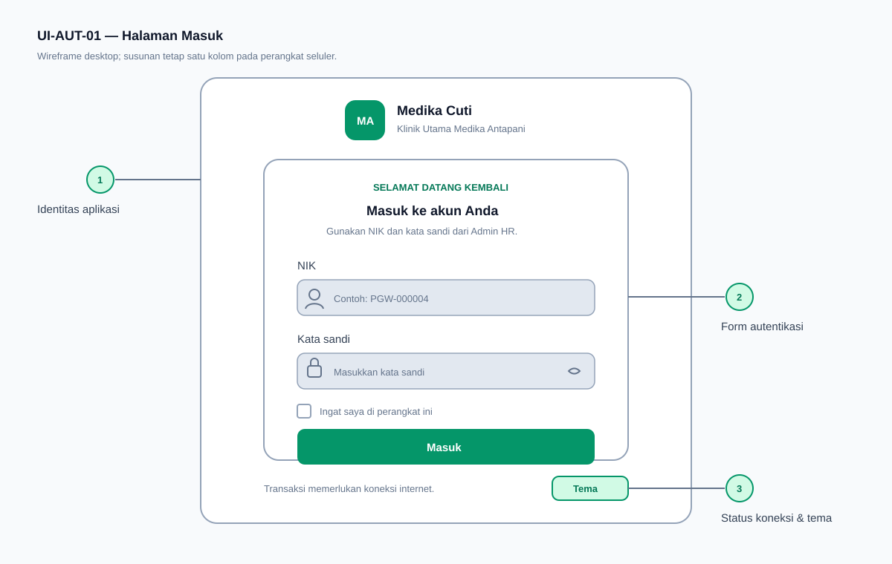

*Gambar 1. Wireframe halaman masuk Medika Cuti.*

Halaman masuk menjadi satu-satunya gerbang autentikasi bagi Karyawan, Atasan, dan Admin HR. Tidak ada pilihan peran pada formulir. Pengguna masuk menggunakan NIK dan kata sandi, sedangkan peran diperoleh dari akun yang berhasil diautentikasi. NIK merujuk pada `pegawai.nomor_induk` dan tidak disalin ke tabel `pengguna`.

Komponen utamanya meliputi:

- identitas aplikasi dan Klinik Utama Medika Antapani;
- kolom NIK dan kata sandi;
- tombol untuk menampilkan atau menyembunyikan kata sandi;
- pilihan untuk mengingat sesi pada perangkat;
- tombol masuk sebagai tindakan utama;
- pesan validasi yang ditempatkan dekat kolom terkait;
- informasi kebutuhan koneksi dan tombol pengubah tema.

Pada ponsel maupun desktop, formulir tetap menggunakan satu kolom agar alur pengisian konsisten. Lebar kartu dibatasi pada desktop dan mengikuti lebar layar dengan jarak tepi yang cukup pada ponsel.

### Navigasi Karyawan dan Atasan

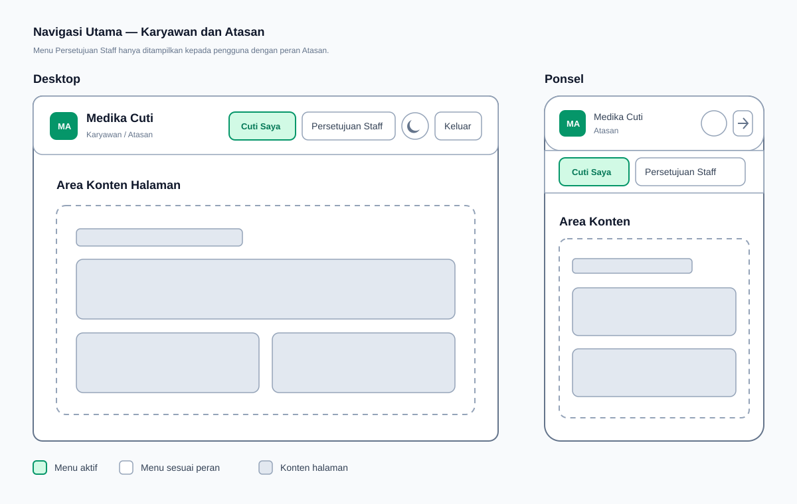

*Gambar 2. Wireframe navigasi Karyawan dan Atasan pada desktop dan ponsel.*

Navigasi Karyawan dan Atasan menggunakan header horizontal. Identitas aplikasi dan peran tampil di sisi kiri, sedangkan menu, pengubah tema, dan tombol keluar berada di sisi kanan. Menu `Cuti Saya` tersedia bagi kedua peran. Menu `Persetujuan Staff` hanya tersedia bagi Atasan.

Pada ponsel, menu utama dipindahkan ke baris kedua yang dapat digulir secara horizontal. Pola ini menjaga tindakan utama tetap terlihat tanpa menggunakan sidebar dan tanpa mengurangi ruang konten secara permanen.

### Navigasi Admin HR

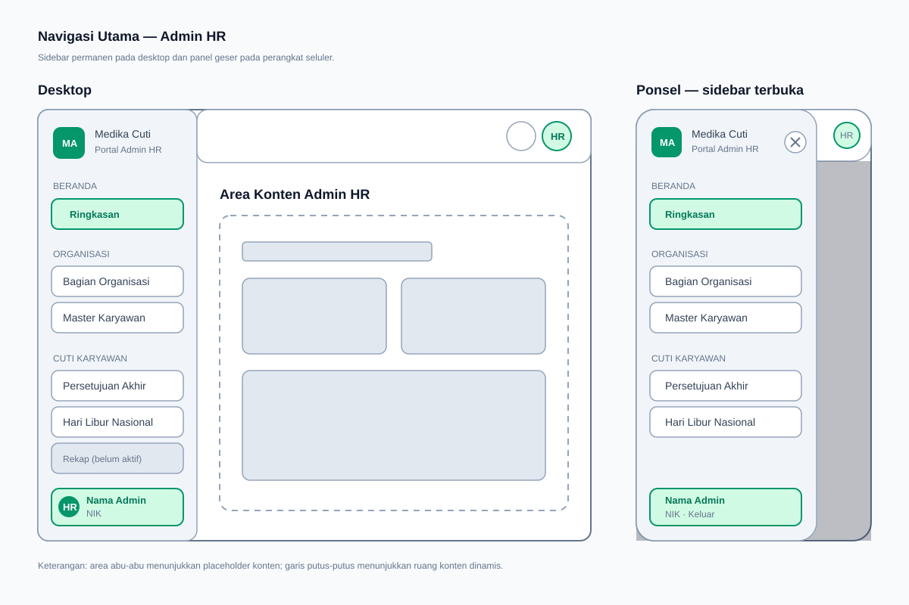

*Gambar 3. Wireframe navigasi Admin HR pada desktop dan ponsel.*

Navigasi Admin HR menggunakan sidebar karena jumlah menu dan kelompok tugas lebih banyak. Menu dikelompokkan menjadi Beranda, Organisasi, dan Cuti Karyawan. Bagian bawah sidebar memuat identitas pengguna dan tindakan keluar. Header area kerja memuat pengubah tema serta ringkasan identitas pengguna.

Pada desktop, sidebar tetap terlihat di sisi kiri. Pada layar yang lebih kecil, sidebar disembunyikan dan dibuka melalui tombol menu sebagai panel geser di atas lapisan gelap. Panel menyediakan tombol tutup dan tidak mengubah urutan menu.

### Ketentuan Umum Navigasi

- Menu aktif harus dapat dikenali melalui teks, bentuk, dan penanda visual, bukan warna saja.
- Menu hanya ditampilkan jika sesuai dengan peran dan kewenangan pengguna.
- Perubahan tema tersedia pada halaman masuk dan seluruh halaman setelah autentikasi.
- Tombol keluar harus mudah ditemukan dan mengakhiri sesi melalui permintaan yang terlindungi.
- Identitas aplikasi menggunakan nama Medika Cuti dan identitas Klinik Utama Medika Antapani.
- Urutan navigasi tidak berubah antara desktop dan ponsel agar pengguna tidak perlu mempelajari ulang susunan menu.

## Wireframe Dashboard Karyawan

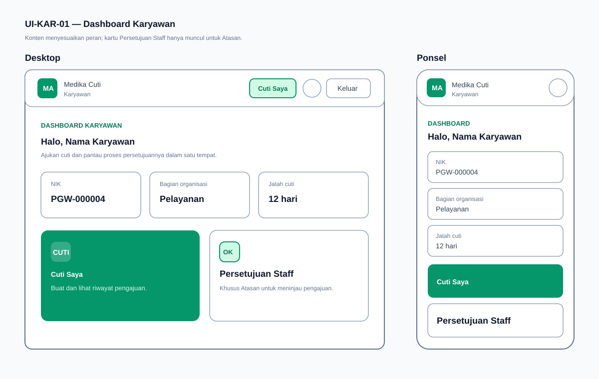

*Gambar 4. Wireframe dashboard Karyawan dan variasi menu bagi Atasan.*

Dashboard menampilkan identitas kerja berupa NIK, bagian organisasi, dan jatah cuti. Pintasan `Cuti Saya` tersedia bagi seluruh pegawai, sedangkan pintasan `Persetujuan Staff` hanya ditampilkan kepada Atasan. Pada ponsel, kartu informasi dan pintasan disusun vertikal.

## Wireframe Cuti Saya

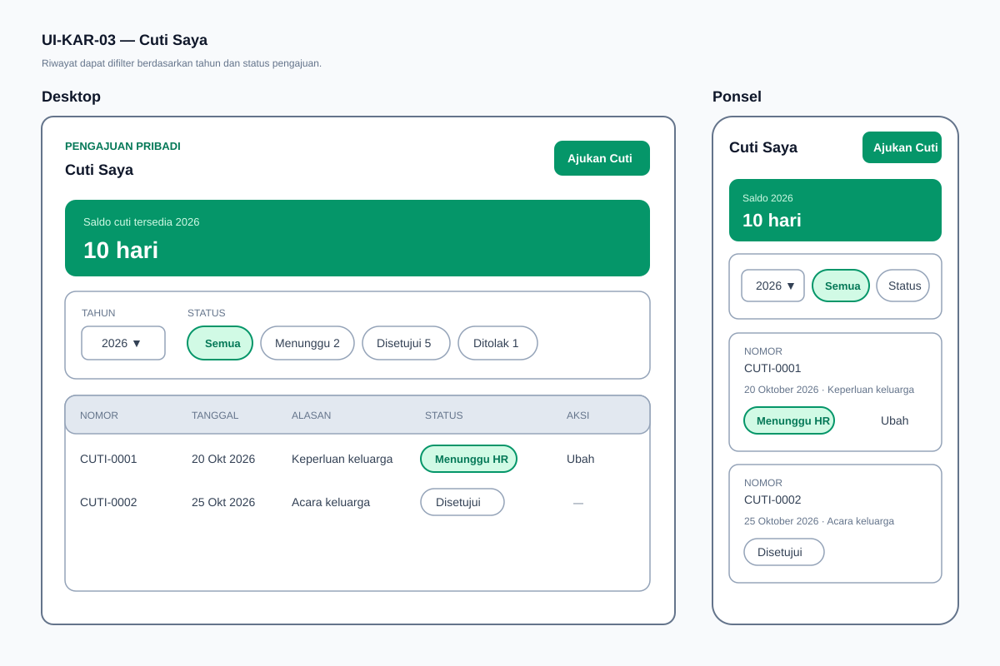

*Gambar 5. Wireframe daftar dan penyaringan pengajuan pribadi.*

Halaman ini menampilkan saldo cuti tersedia berdasarkan tahun, filter status beserta jumlah data, dan riwayat pengajuan. Tabel desktop berubah menjadi kartu berlabel pada ponsel. Tindakan `Ubah` dan `Batalkan` hanya muncul selama pengajuan belum memperoleh keputusan.

## Wireframe Form Pengajuan

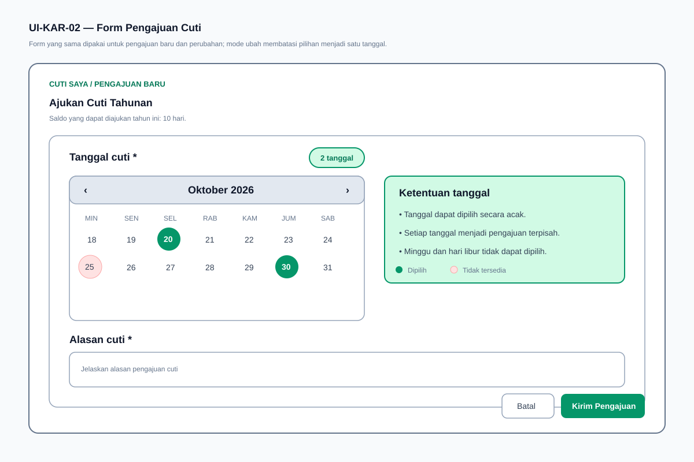

*Gambar 6. Wireframe formulir pengajuan dan perubahan cuti.*

Pengguna memilih satu atau beberapa tanggal melalui kalender, kemudian mengisi alasan cuti. Setiap tanggal yang dipilih disimpan sebagai satu pengajuan terpisah. Hari Minggu dan hari libur nasional tidak dapat dipilih. Pada mode perubahan, kalender hanya menerima satu tanggal pengganti. Pesan validasi ditempatkan di bawah kalender atau kolom alasan yang bermasalah.

## Wireframe Detail Pengajuan

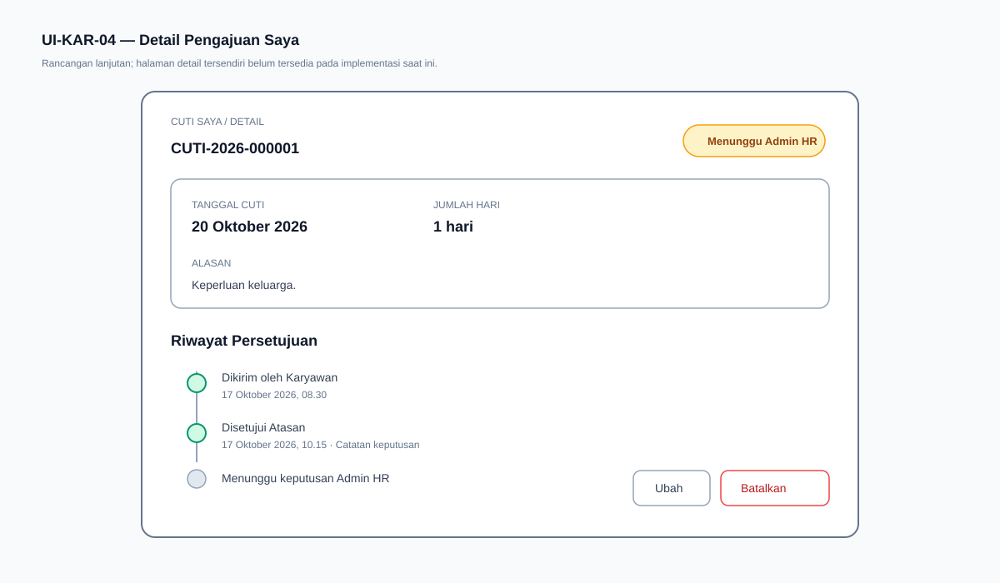

*Gambar 7. Wireframe rancangan lanjutan detail pengajuan pribadi.*

Halaman detail memperlihatkan data pengajuan dan urutan keputusan sebagai garis waktu. Karyawan hanya melihat tindakan yang masih sah sesuai status. Halaman tersendiri ini belum tersedia pada implementasi saat ini; data ringkas dan tindakan masih disajikan melalui halaman `Cuti Saya`.

## Wireframe Daftar dan Keputusan Atasan

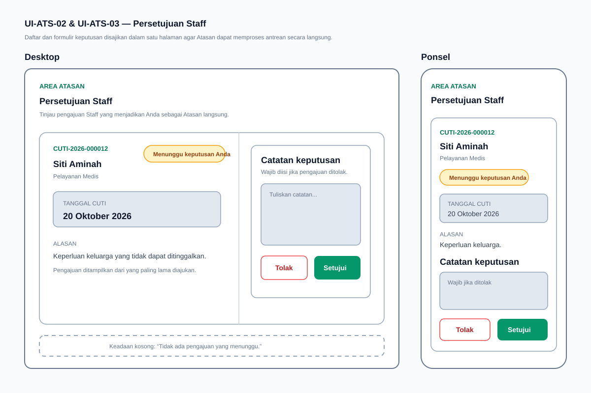

*Gambar 8. Wireframe daftar dan keputusan pengajuan cuti oleh Atasan.*

Pengajuan berstatus `menunggu_atasan` ditampilkan dari yang paling lama diajukan. Setiap kartu memuat nomor pengajuan, nama dan bagian organisasi pegawai, tanggal cuti, alasan, serta formulir keputusan. Catatan bersifat opsional ketika disetujui dan wajib ketika ditolak.

Pada desktop, ringkasan pengajuan dan formulir keputusan ditempatkan berdampingan. Pada ponsel, keduanya disusun vertikal agar informasi dapat dibaca dan tombol keputusan tetap mudah dijangkau. Setelah keputusan berhasil disimpan, kartu dikeluarkan dari antrean dan sistem menampilkan pesan keberhasilan.

Jika tidak terdapat pengajuan, halaman menampilkan keadaan kosong yang menjelaskan bahwa seluruh pengajuan Staff sudah diproses. Tombol keputusan tidak tersedia jika pengguna bukan Atasan yang ditunjuk atau status pengajuan sudah berubah.

Dashboard Atasan menggunakan rancangan dashboard Karyawan pada Gambar 4 dengan tambahan pintasan `Persetujuan Staff`. Riwayat keputusan Atasan dan antrean Manager Operasional masih merupakan rancangan lanjutan dan belum tersedia sebagai halaman tersendiri pada implementasi saat ini.

## Wireframe Dashboard dan Keputusan Admin HR

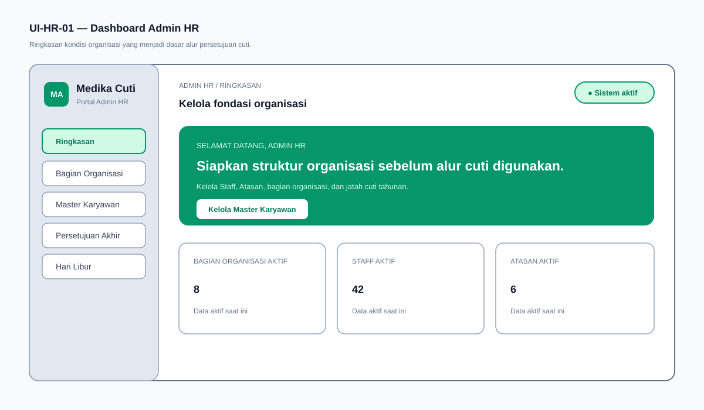

*Gambar 9. Wireframe dashboard Admin HR.*

Dashboard saat ini berfokus pada kesiapan data organisasi. Bagian utama memuat status sistem, sambutan, pintasan ke Master Karyawan, serta jumlah bagian organisasi, Staff, dan Atasan yang aktif.

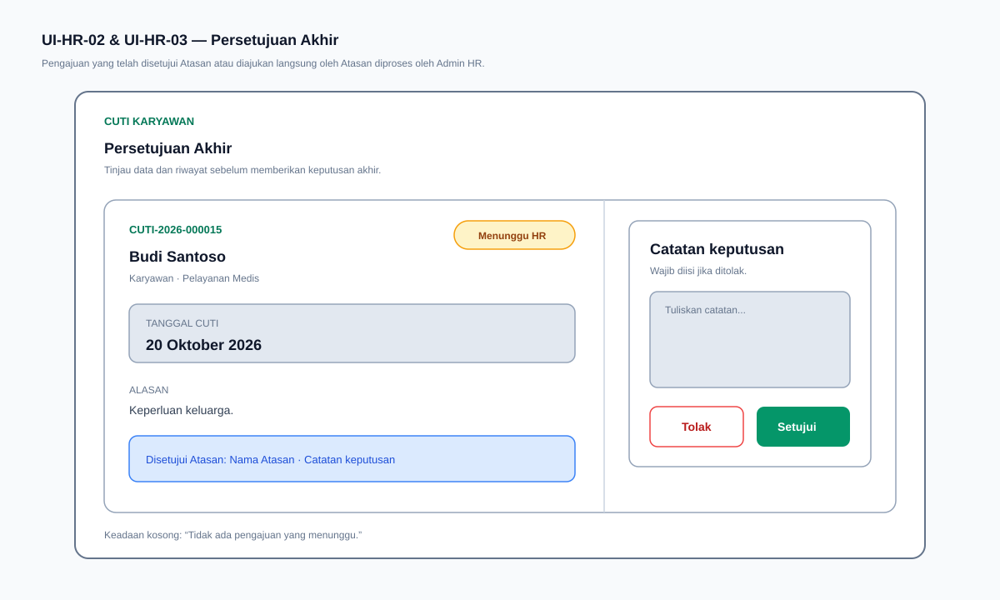

*Gambar 10. Wireframe antrean dan keputusan akhir Admin HR.*

Setiap kartu menampilkan identitas pemohon, tanggal dan alasan cuti, serta keputusan Atasan jika ada. Pengajuan milik Atasan ditandai sebagai pengajuan yang langsung masuk ke Admin HR. Catatan wajib ketika pengajuan ditolak. Persetujuan akhir memperbarui status dan saldo cuti melalui proses server.

## Wireframe Pengelolaan Data Admin HR

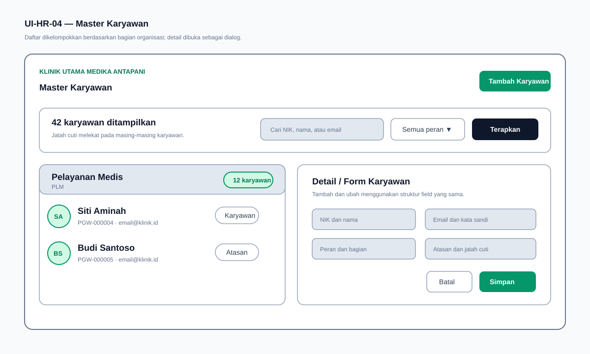

*Gambar 11. Wireframe daftar, detail, dan formulir Master Karyawan.*

Master Karyawan menyediakan pencarian berdasarkan NIK, nama, atau email serta filter peran. Karyawan dikelompokkan berdasarkan bagian organisasi. Detail dibuka melalui dialog, sedangkan halaman tambah dan ubah menggunakan struktur formulir yang sama.

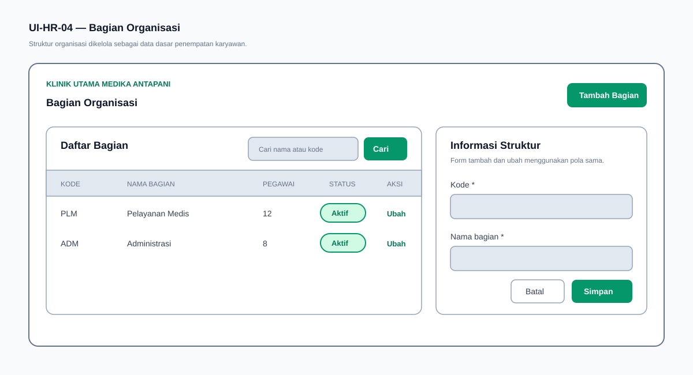

*Gambar 12. Wireframe daftar dan formulir Bagian Organisasi.*

Daftar menampilkan kode, nama bagian, jumlah pegawai, status, dan tindakan ubah. Form tambah dan ubah berisi informasi struktur yang sama agar pola pengelolaan tetap konsisten.

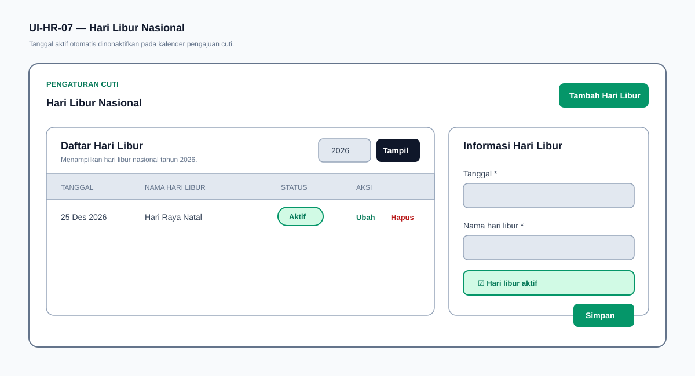

*Gambar 13. Wireframe daftar dan formulir Hari Libur Nasional.*

Admin HR dapat memilih tahun, menambah, mengubah, atau menghapus hari libur. Tanggal yang berstatus aktif tidak dapat dipilih pada kalender pengajuan cuti.

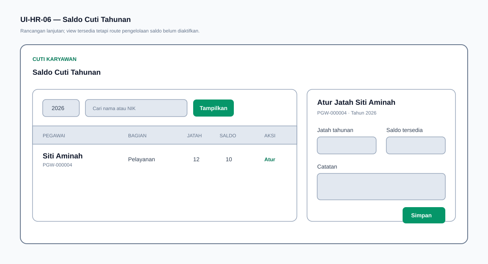

*Gambar 14. Wireframe rancangan lanjutan pengelolaan saldo cuti.*

Daftar saldo menyediakan filter tahun dan pencarian pegawai. Form pengaturan memuat jatah tahunan, saldo tersedia, dan catatan penyesuaian. View sudah tersedia, tetapi route dan menu pengelolaan saldo belum diaktifkan pada implementasi saat ini.

## Wireframe Rekap

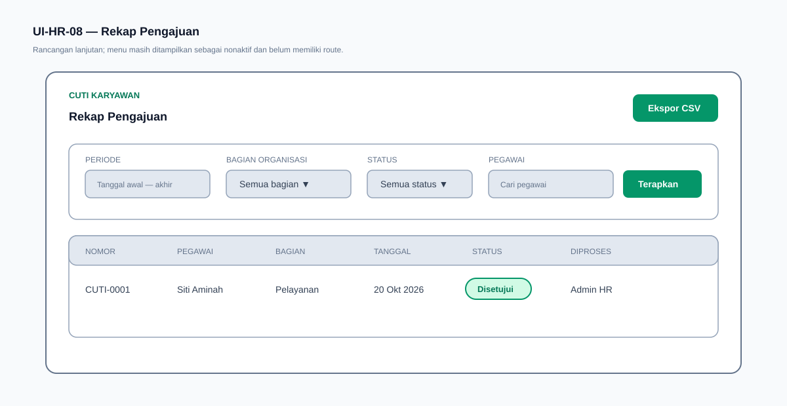

*Gambar 15. Wireframe rancangan lanjutan rekap pengajuan.*

Rekap menyediakan filter periode, bagian organisasi, status, dan pegawai. Ekspor CSV harus menggunakan filter dan hak akses yang sama dengan data pada layar. Menu Rekap saat ini masih nonaktif dan belum memiliki route.

## Wireframe Halaman Offline

```text
+--------------------------------------------------+
|                   Tidak Ada Koneksi              |
|                                                  |
| Aplikasi memerlukan internet untuk memuat data,  |
| mengirim pengajuan, dan memberikan keputusan.    |
|                                                  |
| [                  Coba Lagi                   ] |
+--------------------------------------------------+
```

Halaman offline tidak menampilkan data pribadi dari cache dan tidak menyediakan tombol untuk menyimpan transaksi.

## Status dan Label

| Status | Label tampilan | Makna singkat |
| --- | --- | --- |
| `draf` | Draf | Belum dikirim. |
| `menunggu_atasan` | Menunggu Atasan | Menunggu keputusan tahap pertama. |
| `menunggu_mo` | Menunggu MO | Menunggu keputusan Manager Operasional. |
| `menunggu_hr` | Menunggu Admin HR | Seluruh tahap organisasi selesai dan menunggu keputusan akhir. |
| `disetujui` | Disetujui | Keputusan akhir diberikan dan saldo telah diperbarui. |
| `ditolak` | Ditolak | Ditolak pada salah satu tahap. |
| `dibatalkan` | Dibatalkan | Dibatalkan sesuai kewenangan dan aturan saldo. |

Warna akhir ditetapkan pada tahap desain visual. Setiap badge wajib memuat teks sehingga makna tetap jelas bagi pengguna yang tidak membedakan warna tertentu.

## Keadaan Antarmuka yang Wajib Dirancang

- Memuat data.
- Daftar kosong.
- Berhasil menyimpan draf.
- Berhasil mengirim atau memberikan keputusan.
- Validasi field gagal.
- Akses ditolak.
- Data telah berubah atau diproses pengguna lain.
- Saldo tidak lagi mencukupi.
- Koneksi terputus.
- Kesalahan server tanpa membocorkan rincian teknis.

## Perilaku Responsif

- Pada ponsel, sidebar berubah menjadi menu yang dapat dibuka dan ditutup.
- Kartu ringkasan disusun satu kolom pada layar sempit dan beberapa kolom pada layar lebih lebar.
- Tabel menggunakan gulir horizontal atau berubah menjadi kartu ringkas.
- Tombol utama tetap mudah dijangkau tanpa menutupi konten.
- Form menggunakan satu kolom pada ponsel dan dapat memakai dua kolom untuk field pendek pada desktop.
- Dialog keputusan menggunakan hampir seluruh lebar layar pada ponsel.
- Teks, target sentuh, fokus keyboard, dan kontras harus tetap dapat digunakan.

## Kriteria Penerimaan Rancangan Antarmuka

- Setiap kebutuhan fungsional memiliki halaman atau tindakan yang dapat ditemukan.
- Menu yang ditampilkan sesuai peran pengguna.
- Atasan dan Admin HR dapat mengajukan cuti pribadi tanpa memperoleh tombol untuk memutus pengajuannya sendiri.
- Status menggunakan tujuh nilai resmi dan label yang konsisten.
- Form pengajuan menampilkan jenis, saldo, tanggal, jumlah hari, alasan, serta ringkasan sebelum dikirim.
- Penolakan dan pembatalan meminta alasan yang diwajibkan.
- Persetujuan akhir menjelaskan dampak terhadap saldo.
- Ekspor rekap tersedia hanya untuk Admin HR dan menghasilkan CSV.
- Halaman offline tidak menawarkan transaksi atau menampilkan data pribadi dari cache.
- Wireframe dapat diterapkan pada ponsel, tablet, dan desktop tanpa mengubah alur bisnis.

## Urutan Implementasi Antarmuka

1. Layout, navigasi, dan komponen status.
2. Halaman masuk dan dashboard pribadi.
3. Form, riwayat, dan detail pengajuan Karyawan.
4. Daftar serta detail keputusan Atasan.
5. Daftar serta detail keputusan Admin HR.
6. Pengelolaan data utama dan rekap.
7. Halaman offline dan penyempurnaan responsif.

Implementasi dimulai setelah struktur database dan kontrak data untuk halaman terkait telah disepakati.
